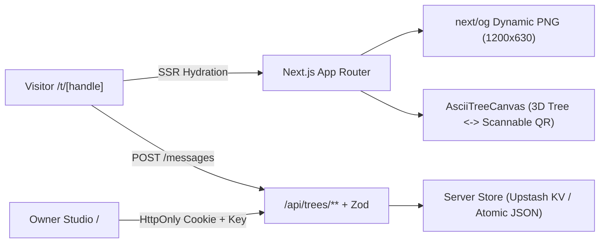

<div align="center">

# Hoho.xo

**Your bio link as a luminous 3D ASCII Christmas tree & scannable QR card.**

*made by [noodlestack](https://github.com/noodlestack)*

[](https://nextjs.org/)
[](https://react.dev/)
[](https://www.typescriptlang.org/)
[](https://tailwindcss.com/)
[](https://vitest.dev/)
[](LICENSE)

</div>

---


**Hoho.xo** turns your personal bio link into an interactive 3D ASCII Christmas tree and a razor-clean, scannable dark-canvas QR code. Share your link or QR on Instagram Stories, X, or WhatsApp—friends scan or open `/t/[handle]` with zero sign-in to hang anonymous holiday notes as glowing ornaments on your tree.

---

## Features

- **Strict Owner vs. Visitor Isolation (`/` vs. `/t/[handle]`)**
  - **Owner Studio (`/`)**: Protected by an automatic cryptographic `HttpOnly` session cookie + backup **Owner Access Key** for cross-device recovery, featuring a 3-tab Creator Studio (**Share**, **Style**, **Prompt**), one-tap `"Unwrap newest unread"` spotlight, live Mail polling, and `.txt` keepsake archive exports.
  - **Visitor Bio Link (`/t/[handle]`)**: SSR-hydrated anonymous compose experience showing only sanitized ornament positions—never message bodies, read status, hidden word lists, or owner controls—with `sessionStorage` draft auto-save, `Ctrl/Cmd+Enter` quick send, character progress bar, and celebratory confetti.
- **3D ASCII Tree & Tap-to-QR Morphing**
  - Hardware-friendly 2D canvas projection (~6,600 adaptive points on desktop, tuned density on mobile) with a cached radial glow sprite, `IntersectionObserver` off-screen frame pausing, and 2-finger pinch-to-zoom.
  - Tapping empty sky, the footer pill, or pressing `Q` smoothly fades atmospheric effects and morphs the tree into a scannable QR code wrapped in a strict 4-module quiet zone linking directly to `/t/[handle]`.
- **Deep Customization & Holiday Atmosphere**
  - **10 Color Themes** (`Classic`, `Fairy`, `Pine`, `Snow`, `Midnight`, `Blush`, `Aurora`, `Silver`, `Ember`, `Mint`).
  - **6 Tree Toppers** (`Star`, `Sparkle`, `Snowflake`, `Heart`, `Crown`, `Bow`) & **4 Silhouettes** (`Classic`, `Slim`, `Bonsai`, `Full`).
  - **5 Animated Winter Sceneries** (`Snowfall`, `Aurora`, `Starlight`, `Blizzard`, `Hearth`).
  - **16 Ornament Styles** (the newest **100** visible notes decorate the 3D tree, while **Mail** retains the complete archive).
- **Web Audio Christmas Music Box**
  - Built-in synthesized celesta music box featuring 4 holiday carols (`Play`/`Pause`/`Next Carol`) plus soft interactive chimes—strictly opt-in via user gesture.
- **Private Mail Archive & `1080×1920` Story Cards**
  - Accessible Vaul slide-over Mail drawer & swipe-to-dismiss note sheets with Search, `All`/`Unread`/`Reported` filters, `Mark all read`, `Wrap Dec 25` lock mode, and `1080×1920` IG Story PNG exports across 4 vibes (`Night`, `Pine`, `Ember`, `Blush`).
  - Dynamic `1200×630` OpenGraph social cards generated via `next/og` for both `/` and `/t/[handle]`.
- **Security, Moderation & Rate Limits**
  - Strict `zod` schema validation on every `/api/trees/**` endpoint.
  - Sliding-window IP rate limits (`6/min` and `30/hr` per visitor IP + handle; `20/hr` production claim limit), honeypot trap, `Pause inbox` toggle, one-click report/delete, and `classifyMessage` filtering (URLs, emails, phones, and owner-muted words).
  - Security headers (`Content-Security-Policy`, `Strict-Transport-Security`, `X-Frame-Options: DENY`, `X-Content-Type-Options: nosniff`).

---

## Architecture



---

## Keyboard & Gesture Controls

| Control | Action |
| :--- | :--- |
| `Q` | Toggle between 3D Tree and scannable QR view |
| `T` | Toggle top-down tree view |
| `M` | Open / close private Mail drawer *(Owner mode)* |
| `N` | Focus anonymous note composer *(Visitor mode)* |
| `ArrowLeft` / `ArrowRight` | Rotate 3D tree horizontally |
| `Ctrl+Enter` / `Cmd+Enter` | Submit anonymous note from composer |
| `?` | Toggle keyboard shortcuts popover *(Desktop)* |
| `Drag` / `Scroll` / `Pinch` | Orbit, wheel-zoom, or 2-finger pinch-zoom tree |

---

## Tech Stack

| Layer | Technology |
| :--- | :--- |
| Framework & Routing | Next.js 16 (`App Router`, `standalone` output) + React 19 + TypeScript 6 |
| Styling & UI Primitives | Tailwind CSS v4, `lucide-react`, `vaul`, `sonner`, `canvas-confetti` |
| Validation & QR | `zod` v4, `qrcode` |
| Canvas, Audio & Exports | HTML5 2D Canvas (`IntersectionObserver` + glow cache), Web Audio API, `next/og` |
| Storage | Upstash Redis / Vercel KV REST (`kv`), Atomic JSON file persistence (`file`), Memory fallback |
| Testing & Tooling | Vitest 5, ESLint 9, TypeScript compiler (`tsc --noEmit`), `pnpm` |

---

## Quick Start

Requires **Node.js 24+** and **pnpm**:

```powershell
pnpm install --frozen-lockfile
pnpm dev
```

- **Owner Hub**: `http://localhost:3000`
- **Public Visitor Page**: `http://localhost:3000/t/noodlestack`
- **Health Check**: `http://localhost:3000/api/health`

## Verification

```powershell
pnpm lint
pnpm typecheck
pnpm test
pnpm build
```

---

## Deployment

### Vercel (+ Upstash Redis / Vercel KV)

1. Push this repository to GitHub and import into Vercel (`pnpm build`, Node 24+).
2. Set `NEXT_PUBLIC_SITE_URL` and connect an **Upstash Redis** / **Vercel KV** database (`UPSTASH_REDIS_REST_URL` and `UPSTASH_REDIS_REST_TOKEN`, or `KV_REST_API_URL` / `KV_REST_API_TOKEN`—see [.env.example](.env.example)).
3. Deploy—`/api/health` will report `"storage": "kv"`, CSP/HSTS headers are active in [next.config.ts](next.config.ts), and `HttpOnly` owner cookies enable cross-request privacy with cross-device recovery via Owner Access Key.

### Docker Standalone

```powershell
pnpm build
docker build -t hoho-xo .
docker run --rm -p 3000:3000 -e NEXT_PUBLIC_SITE_URL=https://your-domain.com -v hoho_data:/app/.data hoho-xo
```

The container pre-creates `/app/.data` owned by `nextjs:nodejs` (configurable via `HOHO_STORE_FILE`) and includes a built-in `HEALTHCHECK` targeting `/api/health`.

---

## License

Released under the [MIT License](LICENSE). Built by [noodlestack](https://github.com/noodlestack).
