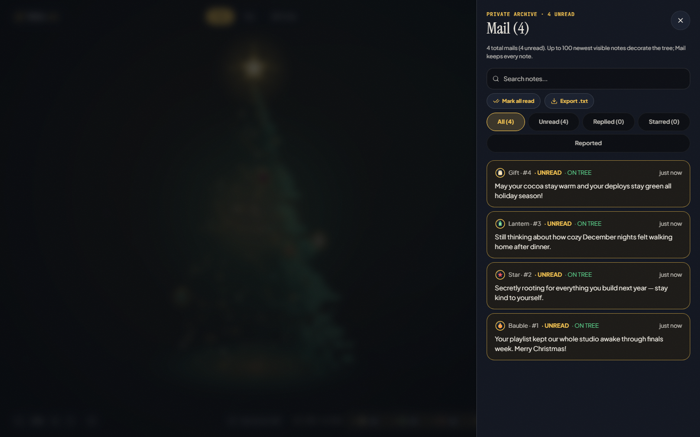

<div align="center">


# Hoho.xo

**Your bio link as a luminous 3D ASCII Christmas tree & scannable QR card.**

*made by [noodlestack](https://github.com/noodlestack)*

[](https://nextjs.org/)
[](https://react.dev/)
[](https://www.typescriptlang.org/)
[](https://tailwindcss.com/)
[](https://vitest.dev/)
[](LICENSE)

</div>

---

<!-- HERO_MEDIA_START -->
> Live demo recording and updated studio/mobile screenshots follow below.
<!-- HERO_MEDIA_END -->

**Hoho.xo** turns your bio link into a volumetric, ASCII-rendered 3D Christmas tree that morphs into a scannable dark-canvas QR code. Visitors open `/t/[handle]` with zero sign-in to hang anonymous notes as jewel ornaments—then Owners unwrap them inside a private `HttpOnly`-cookie Mail drawer and export `1080×1920` Instagram/TikTok Story cards.

---

## Highlights & Features

- **Volumetric 3D ASCII Tree & Radial-Wave QR Morph (`AsciiTreeCanvas`)**
  - ~6,600 adaptive 3D points with orbiting Lambert lighting, single-hue depth shading, sparse twinkling lights (`<= 7%`), continuous helical garland, gentle height-dependent wind sway, and a skippable 1.4s GSAP bottom-to-top grow animation.
  - Press `Q` or tap empty sky to morph the tree point cloud outward in a `<= 1.2s` radial wave into a strict 4-module quiet-zone scannable QR plate.
- **Hanging Jewel Ornaments & Live Arrival Motion**
  - Up to 100 latest visible notes render as high-contrast jewel ornaments with soft unread halos, dark backing disks, and top-left specular highlights.
  - Newly delivered notes drop `-120px` onto their branch with a gold landing flash and a 2.2s damped pendulum swing, while Owner Mail polls `/mail?summary=1` every 12s with a live unread pill tick.
- **Strict Owner vs. Visitor Privacy ([SECURITY.md](SECURITY.md))**
  - **Owner Studio (`/`)**: Claim a 3–20 char handle with a one-time recovery key stored server-side via SHA-256 and authenticated via an `HttpOnly` session cookie (`__Host-` in production) + same-origin CSRF enforcement (`Origin`/`Referer`).
  - **Visitor Bio Link (`/t/[handle]`)**: SSR-hydrated anonymous composer showing zero message text, zero read status, and zero sender metadata. Includes Taglish & English prompt presets, 16 ornament picks, `sessionStorage` drafts, a flying GSAP send-arc, tactile haptics, and a viral `"Get your own tree →"` celebration loop.
- **3 IG/TikTok Story Invite Templates & Reply-on-Story Cards**
  - Preview and share `1080×1920` Story invites (`QR Forward`, `Big Prompt`, `Minimal`) designed with a calm lower-middle link-sticker band, plus anonymous note cards with optional 140-char Owner replies via Web Share API (PNG download fallback).
- **Mobile-First Vaul Bottom Sheet & PWA Ready**
  - Viewports below `768px` keep the tree taking the upper canvas (`>= 58%`) behind a draggable Vaul bottom sheet (`Studio` / `Send note`) with crisp `192×192`, `512×512`, and `apple-touch-icon` PNG assets.
  - Optional VAPID Web Push (`src/lib/push.ts` + `public/sw.js` via Next.js 16 `after()`) coalesces alerts to max 1/min across up to 5 devices and never transmits note text.
- **Security, Moderation & Fail-Closed Rate Limits**
  - `zod` v4 validation, `Idempotency-Key` deduplication, local `classifyMessage` filtering, owner muted words, honeypot trap, and fail-closed (`503`) Upstash Redis sliding-window rate limits with HMAC-SHA256 IP hashing (`HOHO_IP_SALT`).

---

## Architecture

```mermaid
flowchart LR
  V["Visitor /t/[handle]"] -->|SSR Hydration| Page["Next.js 16 App Router"]
  O["Owner Studio /"] -->|HttpOnly Cookie| API["/api/trees/** + Zod"]
  V -->|POST /messages| API
  API --> Store["Store Adapters (Upstash KV / Atomic JSON / Memory)"]
  API -->|after() Coalesced Push| SW["/sw.js Web Push"]
  Page --> OG["next/og Dynamic PNG (1200x630)"]
  Page --> Canvas["AsciiTreeCanvas (2D Canvas + GSAP)"]
```

---

## Screenshots

| Owner Studio (`1440×900`) | Radial QR Mode (`1440×900`) |
| :---: | :---: |
|  |  |

| Private Mail Drawer (`1440×900`) | Mobile Visitor Composer & Sent (`390×844`) |
| :---: | :---: |
|  |   |

---

## Keyboard & Gesture Controls

| Control | Action |
| :--- | :--- |
| `Q` | Toggle between 3D Tree and scannable QR view |
| `T` | Toggle top-down tree view |
| `M` | Open / close private Mail drawer *(Owner mode)* |
| `N` | Focus anonymous note composer *(Visitor mode)* |
| `ArrowLeft` / `ArrowRight` | Rotate 3D tree horizontally |
| `Ctrl+Enter` / `Cmd+Enter` | Submit anonymous note from composer |
| `?` | Toggle keyboard shortcuts popover *(Desktop)* |
| `Drag` / `Scroll` / `Pinch` | Orbit, wheel-zoom, or 2-finger pinch-zoom tree |

---

## Tech Stack

| Layer | Technology |
| :--- | :--- |
| Framework & Routing | Next.js 16 (`App Router`, `standalone`), React 19, TypeScript 6 |
| Styling & UI Primitives | Tailwind CSS v4, `lucide-react`, `vaul`, `sonner`, `canvas-confetti` |
| Motion & Audio | `gsap` v3 (`SplitText`, `@gsap/react`), Web Audio API synthesizer + CC0 loader |
| Validation, QR & Push | `zod` v4, `qrcode`, `web-push` v4 |
| Storage & Rate Limits | `@upstash/redis` & `@upstash/ratelimit` (`hoho:v2:*`), Atomic JSON (`file`), Memory |
| Verification | Vitest 5, ESLint 9, TypeScript (`tsc --noEmit`), Playwright headless Chromium |

---

## Quick Start

Requires **Node.js 24+** and **pnpm**:

```powershell
pnpm install --frozen-lockfile
pnpm dev
```

Open `http://localhost:3000` in your browser, claim a handle on **Prompt**, share `/t/[handle]`, and inspect incoming ornaments in **Mail**.

### Verification Suite

```powershell
pnpm lint
pnpm typecheck
pnpm test
pnpm build
```

---

## Deployment

### Vercel (+ Upstash Redis / Vercel KV — Required)

> **Important:** **Vercel requires Upstash Redis / Vercel KV** (`UPSTASH_REDIS_REST_URL` / `UPSTASH_REDIS_REST_TOKEN` or `KV_REST_API_URL` / `KV_REST_API_TOKEN`). Without KV on Vercel in production, tree claims and note submissions return `503` and `/api/health` returns `503` (`durable: false`) rather than falling back to ephemeral instance memory.

1. Push this repository to GitHub and import into Vercel (`pnpm build`, Node 24+).
2. Configure `NEXT_PUBLIC_SITE_URL`, `HOHO_IP_SALT`, `HOHO_TRUSTED_PROXY=vercel`, and connect an **Upstash Redis** database (see [.env.example](.env.example)).
3. Deploy — `/api/health` reports `"storage": "kv"` and `"durable": true`, CSP/HSTS headers are active in [next.config.ts](next.config.ts), and `__Host-` `HttpOnly` cookies protect Owner Studio and Mail.

### Docker Standalone

```bash
pnpm build
docker build -t hoho-xo .
docker run --rm -p 3000:3000 -e NEXT_PUBLIC_SITE_URL=https://your-domain.com -v hoho_data:/app/.data hoho-xo
```

### Environment Variables

| Variable | Required | Default | Purpose |
| :--- | :--- | :--- | :--- |
| `NEXT_PUBLIC_SITE_URL` | Recommended | `http://localhost:3000` (dev) | Canonical origin for metadata, OG cards, and same-origin checks |
| `HOHO_IP_SALT` | Yes (prod) | Dev fallback in non-prod | Secret salt for HMAC-SHA256 rate-limit IP hashing |
| `HOHO_TRUSTED_PROXY` | Recommended | `none` | Client IP header source: `vercel`, `cloudflare`, or `none` |
| `UPSTASH_REDIS_REST_URL` / `TOKEN` | Yes on Vercel | — | Upstash Redis REST credentials (also accepts `KV_REST_API_*`) |
| `HOHO_REQUIRE_DURABLE` | Optional | Unset | Set `1` in production to return `503` if KV is unconfigured |
| `HOHO_STORE_FILE` | Optional | `.data/hoho-store.json` | Custom JSON store path for self-hosted file mode |
| `HOHO_MAX_MESSAGES_PER_TREE` | Optional | `1000` | Maximum stored notes per tree before returning `429` |
| `HOHO_GLOBAL_MSG_LIMIT` | Optional | `20` | Global per-IP message submissions allowed per 10 minutes |
| `HOHO_HANDLE_HOURLY_LIMIT` | Optional | `200` | Total notes allowed per tree per hour |
| `HOHO_MODERATION_PROVIDER` | Optional | Off | Set `openai` with `OPENAI_API_KEY` for optional `omni-moderation-latest` check |
| `OPENAI_API_KEY` | Optional | — | API key used only when `HOHO_MODERATION_PROVIDER=openai` |
| `NEXT_PUBLIC_VAPID_PUBLIC_KEY` / `VAPID_*` | Optional | Off | VAPID public/private keys & subject (`mailto:...`) enabling owner Web Push alerts |

---

## Repository Docs & Changelog

- [SECURITY.md](SECURITY.md) — Vulnerability disclosure & privacy guarantees
- [CHANGELOG.md](CHANGELOG.md) — Release notes across hardening, UI polish, and presentation
- [docs/presentation.md](docs/presentation.md) — Demo recording workflow & GitHub Settings checklist

## License

Released under the [MIT License](LICENSE). Built by [noodlestack](https://github.com/noodlestack).
