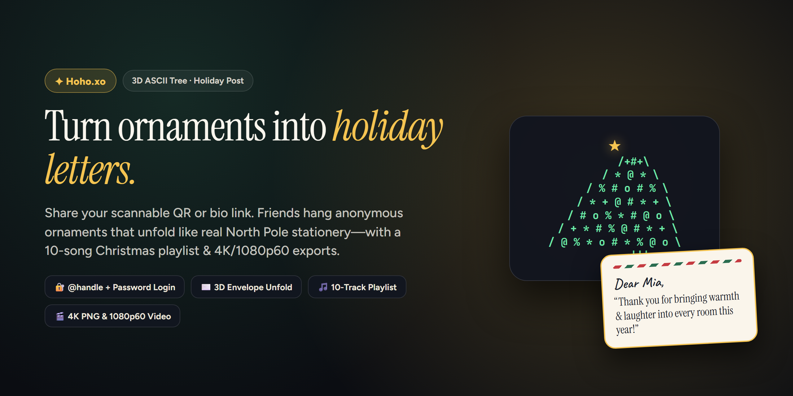
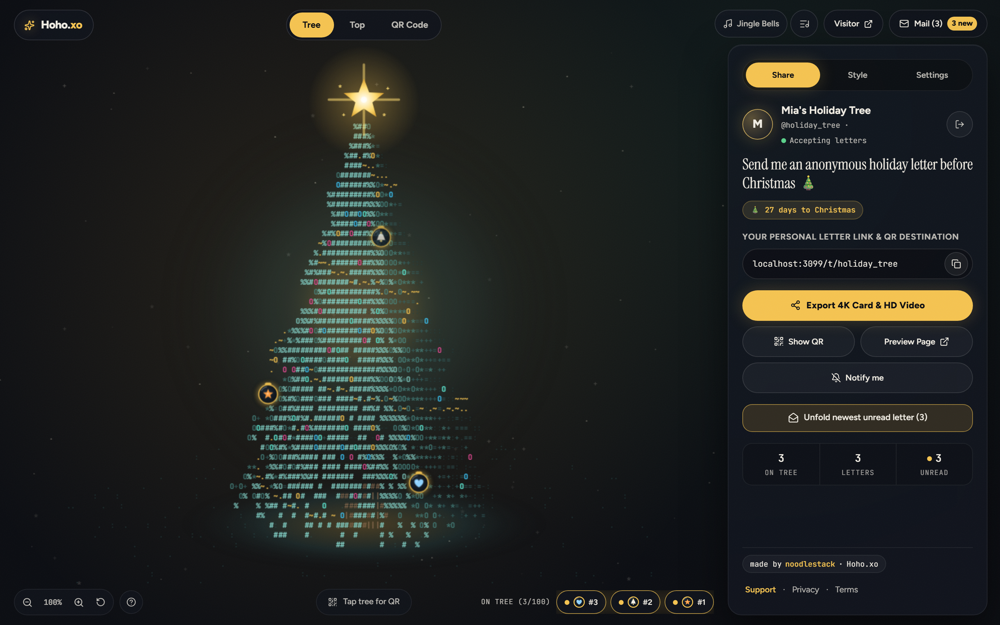
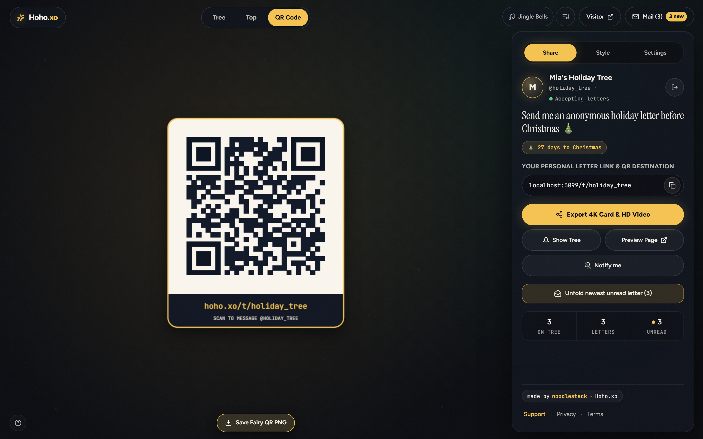
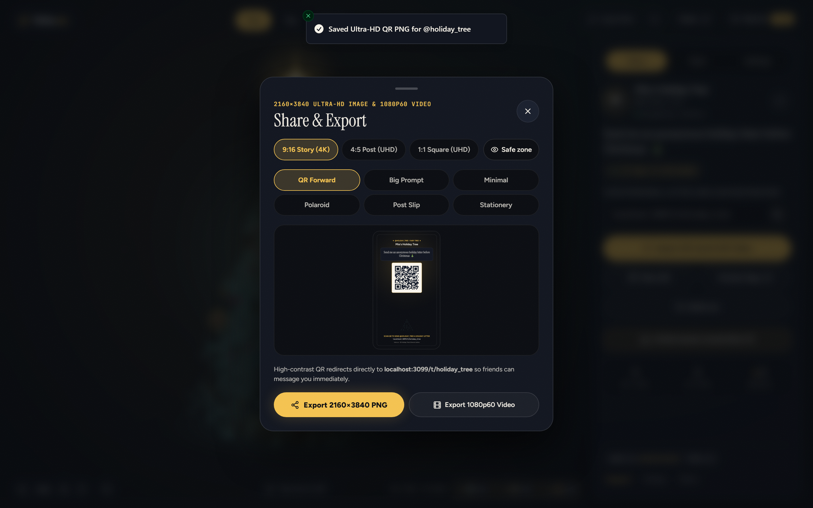
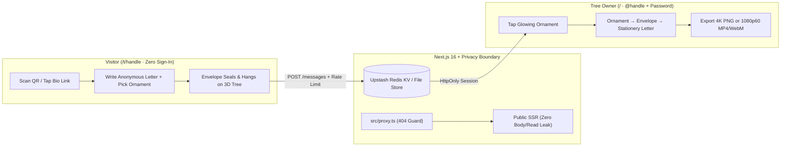

<div align="center">



# 🎄 Hoho.xo

### Plant your 3D holiday tree. Share one QR or bio link. Unfold secret letters on Christmas.

_Crafted by [noodlestack](https://github.com/noodlestack)_

[](https://hoho-xo.vercel.app)
[](https://nextjs.org/)
[](https://react.dev/)
[](https://www.typescriptlang.org/)
[](#verification-suite)
[](LICENSE)

<br />

[**Launch Live Studio →**](https://hoho-xo.vercel.app) · [**Architecture**](#how-it-works) · [**Visual Showcase**](#visual-showcase) · [**Self-Hosting & Vercel**](#deployment) · [**Security & Privacy**](SECURITY.md)

</div>

---

## ✨ Why Hoho.xo?

**Hoho.xo** reimagines anonymous holiday Q&As and digital greeting cards as a tactile, interactive **3D ASCII Christmas Tree & North Pole Post** experience:

1. **Guided 2-Step Setup & Password Login** — Claim your `@handle` with a display name and password in seconds (no email required, multi-device `HttpOnly` sessions, zero confusing secret keys).
2. **Instant-Scan High-Contrast QR Morph** — Press `Q` or tap the starry sky to morph your spinning 3D tree into an `ECC-H` warm-ivory QR card that redirects friends straight to your personal `/t/[handle]` letterbox.
3. **Ornament → Mail Envelope → Stationery Letter Choreography** — Visitors pick from **16 vector jewel decorations** and write an anonymous note with **zero sign-in**. When you tap an ornament on your tree, it gathers into a wax-sealed airmail envelope, flips open in 3D, and slides out warm cream stationery (`Dear <Name>,`).
4. **10-Song Classic Christmas Playlist** — Stream full ensemble holiday recordings (`Jingle Bells`, `Carol of the Bells`, `Silent Night`, `O Holy Night`, `Sugar Plum Fairy`, and more) with shuffle, repeat, and automatic **Celesta Music Box** offline fallback.
5. **Studio-Grade 4K Image & 1080p60 Video Exports** — Export **2160×3840 (4K UHD)** Story/Post cards across 6 editorial templates or record **Full-HD 1080×1920 60fps (`16 Mbps`)** `.mp4` / `.webm` videos—including the full animated envelope-to-letter reveal.

---

## 🖼️ Visual Showcase

| Guided Onboarding & 3D Tree (`1440×900`)  | High-Contrast QR Redirect Plate (`1440×900`) |
| :---------------------------------------: | :------------------------------------------: |
|  |           |

| Unfolded Holiday Stationery Letter (`1440×900`) | 4K Story & 1080p60 Video Studio (`1440×900`)  |
| :---------------------------------------------: | :-------------------------------------------: |
|       |  |

<div align="center">

|                           Mobile Visitor Letterbox (`390×844`)                            |                            Mobile Sealed Celebration (`390×844`)                             |
| :---------------------------------------------------------------------------------------: | :------------------------------------------------------------------------------------------: |
|  |  |

</div>

---

## 🧭 How It Works



---

## 🎹 Keyboard & Gesture Shortcuts

| Shortcut / Gesture          | Action                                                       |
| :-------------------------- | :----------------------------------------------------------- |
| `Q`                         | Morph between 3D ASCII Tree and high-contrast QR Code        |
| `T`                         | Toggle top-down canopy camera                                |
| `M`                         | Open / close private Mail letterbox _(authenticated Owner)_  |
| `N`                         | Focus anonymous letter composer _(Visitor)_                  |
| `Esc`                       | Close active Mail drawer, Letter modal, or Shortcuts popover |
| `ArrowLeft` / `ArrowRight`  | Orbit 3D tree horizontally                                   |
| `Ctrl+Enter` / `Cmd+Enter`  | Seal & send anonymous holiday letter                         |
| `Drag` / `Scroll` / `Pinch` | Orbit 360°, wheel-zoom, or 2-finger pinch-zoom               |

---

## 🛠️ Tech Stack

| Layer                  | Stack                                                                                                        |
| :--------------------- | :----------------------------------------------------------------------------------------------------------- |
| **Framework**          | Next.js `16.4` (`App Router`, `src/proxy.ts`, `standalone`), React `19.3`, TypeScript `6.0`                  |
| **Typography & UI**    | `Figtree` + `Instrument Serif` + `Caveat` + `JetBrains Mono`, Tailwind CSS `v4`, `vaul`, `sonner`            |
| **3D Canvas & Motion** | Custom z-buffered HTML5 2D ASCII renderer (`src/components/tree/`), `gsap` `v3`, CSS 3D envelope flip        |
| **Audio Engine**       | 10 CORS-verified Wikimedia Commons classics + polyphonic WebAudio Celesta synthesizer (`src/lib/sound.ts`)   |
| **Auth & Storage**     | Node `crypto.scryptSync` + HMAC `HttpOnly` cookies, `@upstash/redis` (`hoho:v2:*`), Atomic JSON fallback     |
| **Media Exports**      | 2× Supersampled 4K Canvas PNGs + 60fps `16 Mbps` `MediaRecorder` (`video/mp4` / `video/webm`)                |
| **Quality Gates**      | Vitest `5` (81 unit/route tests), Playwright + `@axe-core/playwright` (13 E2E/a11y/visual specs), ESLint `9` |

---

## 🚀 Quick Start

Requires **Node.js 22+** and **pnpm 10+**:

```powershell
pnpm install --frozen-lockfile
pnpm dev
```

Open `http://localhost:3000` to create your tree (`@handle` + password), test your visitor page at `http://localhost:3000/t/<handle>`, and unfold letters inside **Mail**.

### Verification Suite

```powershell
pnpm typecheck  # Strict TypeScript 6 check
pnpm lint       # ESLint 9 + jsx-a11y rules
pnpm test       # 81 Vitest unit & API security tests
pnpm build      # Next.js 16 production standalone build
pnpm test:e2e   # 13 Playwright E2E, Axe WCAG AA & visual regression tests
```

---

## ☁️ Deployment

### Vercel + Upstash Redis (Recommended)

> [!IMPORTANT]
> Production deployments on Vercel require **Upstash Redis / Vercel KV** (`UPSTASH_REDIS_REST_URL` + `UPSTASH_REDIS_REST_TOKEN`). Without durable KV on Vercel, writes fail closed with `503` so notes are never silently lost on cold starts.

1. Import this repository into [Vercel](https://vercel.com/new).
2. Configure environment variables (see [`.env.example`](.env.example)):
   - `NEXT_PUBLIC_SITE_URL=https://your-domain.vercel.app`
   - `HOHO_IP_SALT=<64-char-hex-secret>`
   - `HOHO_TRUSTED_PROXY=vercel`
   - `UPSTASH_REDIS_REST_URL` & `UPSTASH_REDIS_REST_TOKEN`
3. Deploy — verify `/api/health` returns `{ "ok": true, "storage": "kv", "durable": true }`.

### Docker Standalone

```bash
pnpm build
docker build -t hoho-xo .
docker run --rm -p 3000:3000 -e NEXT_PUBLIC_SITE_URL=https://your-domain.com -v hoho_data:/app/.data hoho-xo
```

---

## 📚 Documentation & License

- [**PRODUCT.md**](PRODUCT.md) — Product positioning, safety principles & WCAG 2.2 AA commitments
- [**SECURITY.md**](SECURITY.md) — Strict visitor anonymity guarantees, Scrypt/HttpOnly auth & vulnerability reporting
- [**CONTRIBUTING.md**](CONTRIBUTING.md) — Local workflow, modularity rules & test gates
- [**CHANGELOG.md**](CHANGELOG.md) — Release history

Released under the [**MIT License**](LICENSE). Made with winter warmth by [**noodlestack**](https://github.com/noodlestack).
