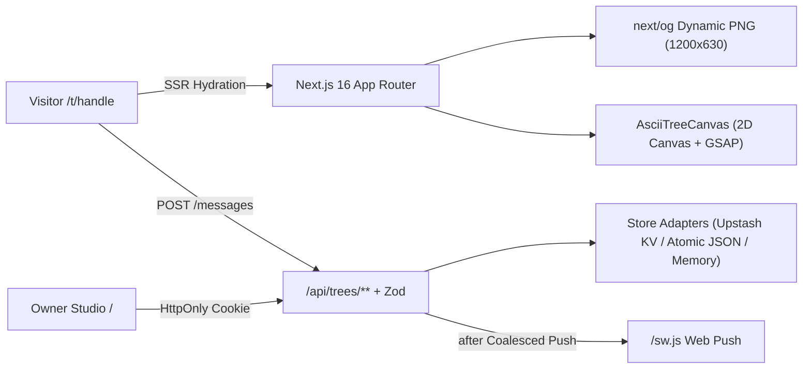
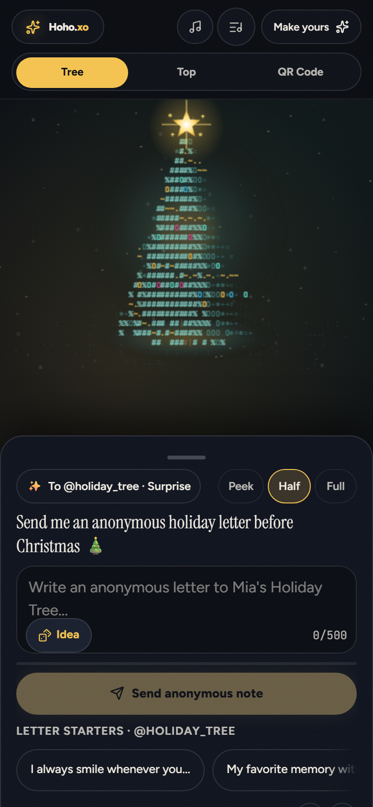
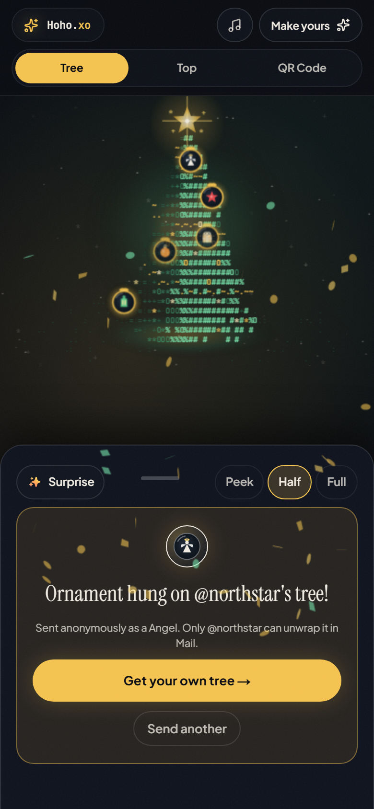

<div align="center">


# Hoho.xo

**Your bio link as a luminous 3D ASCII Christmas tree & scannable QR card.**

_made by [noodlestack](https://github.com/noodlestack)_

[](https://nextjs.org/)
[](https://react.dev/)
[](https://www.typescriptlang.org/)
[](https://tailwindcss.com/)
[](https://vitest.dev/)
[](https://playwright.dev/)
[](https://hoho-xo.vercel.app)
[](LICENSE)

</div>

---

<!-- HERO_MEDIA_START -->
<div align="center">


<sub>Prefer HD video? Download or watch [`docs/assets/demo.mp4`](docs/assets/demo.mp4).</sub>

</div>
<!-- HERO_MEDIA_END -->

**Hoho.xo** turns your social bio link into a 3D volumetric ASCII Christmas tree rendered on an interactive HTML5 canvas. Visitors open `/t/[handle]` with **zero sign-in** to hang anonymous notes as DPR-aware vector jewel ornaments—while Owners unwrap notes inside a private `HttpOnly`-cookie Mail drawer, morph the tree into a scannable QR card (`Q`), and export Instagram/TikTok Story cards and Reels.

---

## Highlights & Features

- **Volumetric 3D ASCII Tree & Radial QR Morph (`AsciiTreeCanvas`)**
  - Blue-noise Fibonacci foliage silhouette (`Classic`, `Alpine`, `Spruce`) with single-hue depth shading, a glowing 5-point vector star topper, 10 WCAG AA checked color palettes (`Classic` default pine + warm gold + midnight), helical lights, and up to 120 snow particles.
  - Adaptive quality tier downgrade monitors frame timing and drops smoothly from `high` → `medium` → `low` on constrained devices (`?debug=1` toggles live FPS/tier diagnostics).
  - Press `Q` or click the starry sky to morph the 3D point cloud into a scannable dark-canvas QR card with a strict 4-module quiet zone.
- **16 Vector Jewel Ornaments & Private Unwrap Studio**
  - Up to 100 latest visible notes hang on branches as cached vector jewel sprites (`src/lib/ornament-sprites.ts`) with unread halos, soft hover focus rings, `>= 24px` touch hit targets, and `-120px` arrival drop + pendulum physics.
  - Owners organize notes across **5 Mail filter tabs** (`All / Unread / Replied / Starred / Reported`), toggle optional **`Caveat` handwriting cards**, swipe between unread notes (`Prev`/`Next` or pointer swipe), and unwrap cards with GSAP `Flip` transitions.
- **6 Story Templates, 3 Aspect Formats & 3s Reel Export**
  - `Share to Story` exports **`QR Forward`**, **`Big Prompt`**, **`Minimal`**, **`Polaroid`**, **`Receipt`**, and **`Sticker`** layouts across **`9:16` (`1080×1920`)**, **`4:5` (`1080×1350`)**, and **`1:1` (`1080×1080`)**, with an interactive **Instagram Safe Zone overlay** and a looping **3-second `.webm` Reel clip** generator.
- **Strict Privacy & Zero-Paywall Architecture ([SECURITY.md](SECURITY.md))**
  - **Visitor Bio Link (`/t/[handle]`)**: SSR-hydrated composer displaying zero message text, zero read/starred/replied flags, zero muted words, and zero sender metadata. Features `Peek / Half / Full` Vaul sheet snaps, prompt starters, a flying send-arc animation, and a viral `"Get your own tree →"` celebration CTA.
  - **Owner Studio (`/`)**: Claim a 3–20 char handle backed by a one-time SHA-256 recovery key and an `HttpOnly` cookie (`__Host-` in production) with same-origin CSRF checks (`Origin`/`Referer`).
  - **Ethical Optional Support**: An unobtrusive `Support` dialog lives solely in Owner Studio (never on `/t/[handle]`), never gates reading notes, themes, or Story exports, and grants only an optional cosmetic Golden Star topper halo via `HOHO_SUPPORTER_CODES`.
- **PWA Offline Fallback & Privacy-Safe Push Alerts**
  - Self-hosted static/push-only Service Worker (`public/sw.js`) caches static app assets cleanly with an interactive `/offline.html` fallback while strictly bypassing all `/api/*` network routes.
  - Optional VAPID Web Push (`src/lib/push.ts` via Next.js 16 `after()`) coalesces alerts across up to 5 owner devices and never sends message text in notifications.

---

## Architecture



---

## Screenshots

|        Owner Studio (`1440×900`)        |  Radial QR Mode (`1440×900`)   |           Story Invite Studio (`1440×900`)           |
| :-------------------------------------: | :----------------------------: | :--------------------------------------------------: |
|  |  |  |

<div align="center">

|   Private Mail Drawer (`1440×900`)   |                           Mobile Visitor Composer (`390×844`)                            |                              Mobile Post-Send Hero (`390×844`)                               |
| :----------------------------------: | :--------------------------------------------------------------------------------------: | :------------------------------------------------------------------------------------------: |
|  |  |  |

</div>

---

## Keyboard & Gesture Controls

| Control                     | Action                                          |
| :-------------------------- | :---------------------------------------------- |
| `Q`                         | Toggle between 3D Tree and scannable QR view    |
| `T`                         | Toggle top-down tree view                       |
| `M`                         | Open / close private Mail drawer _(Owner mode)_ |
| `N`                         | Focus anonymous note composer _(Visitor mode)_  |
| `ArrowLeft` / `ArrowRight`  | Rotate 3D tree horizontally                     |
| `Ctrl+Enter` / `Cmd+Enter`  | Submit anonymous note from composer             |
| `?`                         | Toggle keyboard shortcuts popover _(Desktop)_   |
| `Drag` / `Scroll` / `Pinch` | Orbit, wheel-zoom, or 2-finger pinch-zoom tree  |

---

## Tech Stack

| Layer                   | Technology                                                                                   |
| :---------------------- | :------------------------------------------------------------------------------------------- |
| Framework & Routing     | Next.js 16 (`App Router`, `standalone`), React 19, TypeScript 6                              |
| Styling & UI Primitives | Tailwind CSS v4 (ordered CSS partials), `lucide-react`, `vaul`, `sonner`, `canvas-confetti`  |
| Motion & Audio          | `gsap` v3 (`Flip`, `SplitText`, `@gsap/react`), Web Audio synthesizer + CC0 carol player     |
| Validation, QR & Push   | `zod` v4, `qrcode`, `web-push` v4                                                            |
| Storage & Rate Limits   | `@upstash/redis` & `@upstash/ratelimit` (`hoho:v2:*`), Atomic JSON (`file`), Memory          |
| Quality & Verification  | Vitest 5, ESLint 9 (`jsx-a11y`), TypeScript, Playwright + `axe-core`, Lighthouse CI (`lhci`) |

---

## Quick Start

Requires **Node.js 24+** (see `.nvmrc`) and **pnpm**:

```powershell
pnpm install --frozen-lockfile
pnpm dev
```

Open `http://localhost:3000` to claim your handle on **Prompt**, preview your visitor link at `/t/[handle]`, and unwrap incoming notes inside **Mail**.

### Verification Suite

```powershell
pnpm lint       # ESLint 9 + accessibility rules
pnpm typecheck  # TypeScript check
pnpm test       # Vitest unit & route suite
pnpm build      # Next.js 16 production build
pnpm test:e2e   # Playwright end-to-end, axe-core a11y & visual regression
pnpm lhci       # Lighthouse CI performance, a11y & best-practices budgets
```

---

## Deployment

### Vercel + Upstash Redis (Required in Production)

> **Important:** Production serverless deployments on Vercel require **Upstash Redis / Vercel KV** (`UPSTASH_REDIS_REST_URL` + `UPSTASH_REDIS_REST_TOKEN`, or `KV_REST_API_*`). Without durable KV on Vercel, handle claims and message submissions fail closed with `503` and `/api/health` reports `durable: false`.

1. Push this repository to GitHub and import into Vercel (`pnpm build`, Node 24+).
2. Add `NEXT_PUBLIC_SITE_URL`, `HOHO_IP_SALT`, `HOHO_TRUSTED_PROXY=vercel`, and your **Upstash Redis** credentials (see [.env.example](.env.example)).
3. Deploy — `/api/health` reports `"storage": "kv"` and `"durable": true`, strict CSP/HSTS headers load from [next.config.ts](next.config.ts), and `__Host-` `HttpOnly` cookies isolate owner Mail.

### Docker Standalone

```bash
pnpm build
docker build -t hoho-xo .
docker run --rm -p 3000:3000 -e NEXT_PUBLIC_SITE_URL=https://your-domain.com -v hoho_data:/app/.data hoho-xo
```

### Environment Variables

| Variable                                                                                                  | Required      | Default                       | Purpose                                                                                                            |
| :-------------------------------------------------------------------------------------------------------- | :------------ | :---------------------------- | :----------------------------------------------------------------------------------------------------------------- |
| `NEXT_PUBLIC_SITE_URL`                                                                                    | Recommended   | `http://localhost:3000` (dev) | Canonical origin for metadata, OG cards, and same-origin checks                                                    |
| `HOHO_IP_SALT`                                                                                            | Yes (prod)    | Dev fallback in non-prod      | Secret salt for HMAC-SHA256 rate-limit IP hashing                                                                  |
| `HOHO_TRUSTED_PROXY`                                                                                      | Recommended   | `none`                        | Client IP header source: `vercel`, `cloudflare`, or `none`                                                         |
| `UPSTASH_REDIS_REST_URL` / `TOKEN`                                                                        | Yes on Vercel | —                             | Upstash Redis REST credentials (also accepts `KV_REST_API_*`)                                                      |
| `HOHO_REQUIRE_DURABLE`                                                                                    | Optional      | Unset                         | Set `1` in production to return `503` if KV is unconfigured                                                        |
| `HOHO_STORE_FILE`                                                                                         | Optional      | `.data/hoho-store.json`       | Custom JSON store path for self-hosted file mode                                                                   |
| `HOHO_MAX_MESSAGES_PER_TREE`                                                                              | Optional      | `1000`                        | Maximum stored notes per tree before returning `429`                                                               |
| `HOHO_GLOBAL_MSG_LIMIT`                                                                                   | Optional      | `20`                          | Global per-IP message submissions allowed per 10 minutes                                                           |
| `HOHO_HANDLE_HOURLY_LIMIT`                                                                                | Optional      | `200`                         | Total notes allowed per tree per hour                                                                              |
| `HOHO_MODERATION_PROVIDER`                                                                                | Optional      | Off                           | Set `openai` with `OPENAI_API_KEY` for `omni-moderation-latest` check                                              |
| `OPENAI_API_KEY`                                                                                          | Optional      | —                             | API key used only when `HOHO_MODERATION_PROVIDER=openai`                                                           |
| `NEXT_PUBLIC_VAPID_PUBLIC_KEY` / `VAPID_*`                                                                | Optional      | Off                           | VAPID keys & `mailto:` subject enabling owner Web Push alerts                                                      |
| `NEXT_PUBLIC_KOFI_URL` / `BUYMEACOFFEE` / `PAYPAL` / `PATREON` / `GITHUB_SPONSORS` / `CUSTOM_SUPPORT_URL` | Optional      | Off                           | HTTPS donation URLs displayed only inside Owner Studio `Support` sheet (`CUSTOM_SUPPORT_LABEL` / `_DESC` optional) |
| `NEXT_PUBLIC_SUPPORT_TIP_NOTE`                                                                            | Optional      | —                             | Short maintainer note shown in Owner Studio `Support` sheet                                                        |
| `HOHO_SUPPORTER_CODES`                                                                                    | Optional      | —                             | Comma-separated codes unlocking the cosmetic Golden Star halo in Owner Studio                                      |

---

## Documentation & Community

- [CONTRIBUTING.md](CONTRIBUTING.md) — Development setup, quality gates & privacy/modularity guidelines
- [SECURITY.md](SECURITY.md) — Vulnerability disclosure & strict visitor anonymity guarantees
- [CHANGELOG.md](CHANGELOG.md) — Release history across hardening, canvas polish, Mail/Story upgrades & QA
- [docs/presentation.md](docs/presentation.md) — Demo recording workflow & repository presentation notes

## License

Released under the [MIT License](LICENSE). Built by [noodlestack](https://github.com/noodlestack).
